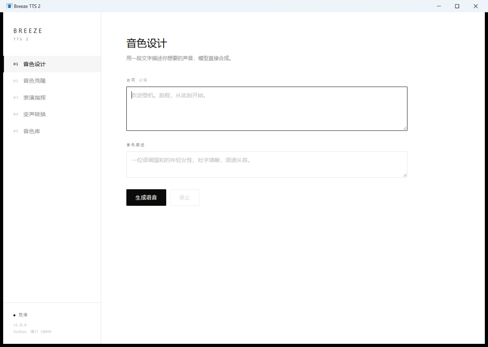

# Breeze TTS 2 桌面版

给 [Breeze TTS 2](https://github.com/HoppouAI/Breeze-TTS-2.cpp) 套一个能双击安装的 Windows 外壳：本地推理、纯黑白界面、全程离线。

后端是原版 `breeze-server` 的量化版（Q4_K），本项目**不含模型权重**，首次启动时下载。



## 它做了什么

原版只有命令行和编译期嵌死的英文 WebUI。这个项目补上三件事：

1. **一个安装包**——`BreezeTTS2Setup.exe`，双击即装，无需管理员权限，不带 2.4 GB 权重。
2. **一个中文界面**——音色设计 / 音色克隆 / 表演指挥 / 变声转换 / 音色库，五页全中文。
3. **一个本地启动器**——`BreezeTTS2.exe` 负责拉起后端、代理接口、下载模型、卸载自己。

## 界面

黑白两色，等宽字体做标注，没有渐变、阴影和圆角。五个功能页面对应后端的三组能力：

| 页面 | 接口 | 说明 |
| --- | --- | --- |
| 音色设计 | `POST /v1/audio/speech` | 用自然语言描述声音，直接合成 |
| 音色克隆 | `POST /v1/voices` | 上传参考音频 + 文本，注册成音色 |
| 表演指挥 | `POST /v1/audio/speech` | 文本与描述分离，边改边听 |
| 变声转换 | `POST /v1/audio/convert` | 保留内容，换音色 |
| 音色库 | `GET/DELETE /v1/voices` | 管理已注册音色 |

音频是**流式**的：后端以 `audio/pcm` 分块返回（24 kHz / s16le / 单声道），前端边收边播，第一块到了就开始出声，不等整段生成完。

## 安装

1. 下载 Releases 里的 `BreezeTTS2Setup.exe`（约 70 MB）。
2. 双击安装。默认装到 `%LOCALAPPDATA%\Programs\BreezeTTS2`，**点「浏览…」可以装到任意目录**（比如 D 盘）；安装向导会先探测目标目录是否可写，不可写直接报错让你换位置。装完创建开始菜单和桌面快捷方式。
3. 首次启动会下载 `breeze-tts-2-q4_k.gguf`（约 2.4 GB）。下载支持断点续传和镜像回退。
4. 模型就位后自动拉起后端，浏览器打开 `http://127.0.0.1:18080`。

卸载走「设置 → 应用 → Breeze TTS 2」，或运行安装目录下的 `BreezeTTS2.exe --uninstall`。

## 自己打包

需要 Windows 自带的 .NET Framework 4.x（`csc.exe`），不需要 SDK、Node、NSIS 或 Inno Setup。

```powershell
# 先把原版后端程序放到 D:\breeze-tts-2（含 breeze-server.exe / libbreeze.dll 等）
powershell -ExecutionPolicy Bypass -File build\build.ps1 -BreezeDir "D:\breeze-tts-2"
```

产物在 `out\BreezeTTS2Setup.exe`。安装包的结构是「PE 外壳 + 追加的 zip + 24 字节尾部索引」：外壳启动后按索引在自身文件里定位 zip 段，用 `SliceStream` 原地解压，不落地临时文件。

## 目录

```
src/launcher/Program.cs   启动器：静态页 + /api 反向代理 + 模型下载 + 卸载
src/setup/Program.cs      安装器：自解压、写注册表、建快捷方式
src/ui/                   界面（原生 HTML/CSS/JS，无框架、无构建）
build/build.ps1           编译 + 打包
```

启动器是唯一 origin：它把 `/api/*` 反代到后端的 `:18099`，所以**不需要给后端开 `--cors`**，也不会撞上跨域限制。

## 实测性能

AMD Radeon 780M 核显 / Q4_K / 16 核 CPU：

| 场景 | Vulkan | CPU |
| --- | --- | --- |
| 长文本（11.4 s 音频） | RTF 3.08（35.3 s） | RTF 6.60（77.6 s） |
| 短句（3.3 s 音频） | RTF 6.7（21.9 s），首音 10.5 s | RTF 7.6（24.8 s），首音 2.7 s |

长文本走 Vulkan 快一倍，短句 CPU 首音更快。启动器默认加 `--no-warmup`。

## 两个坑

- **不要开 warmup**。默认预热在核显上会连续占用 CPU/GPU 十几分钟（实测 CPU 100%、73 °C），而它换来的只是首音快几秒。启动器已经固定关闭。
- **量化档不是越低越快**。声码器权重钉死 F32、不参与量化，降档只掉质量不提速。

## 许可证

- 本项目代码：[Apache-2.0](LICENSE)。
- Breeze TTS 2 模型权重：**BreezeBlue Research and Non-Commercial License**，仅限非商业研究用途。本项目不打包权重，下载行为由使用者自行承担合规责任。
- 后端 `breeze-server` 及其二进制来自 [HoppouAI/Breeze-TTS-2.cpp](https://github.com/HoppouAI/Breeze-TTS-2.cpp)，许可见 THIRD_PARTY_NOTICES。

非官方项目，与上游作者无关。
