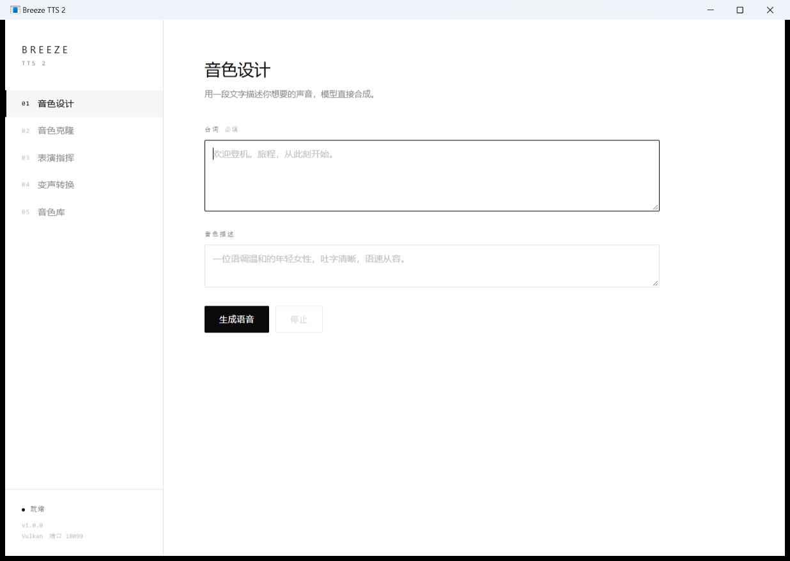

# Breeze TTS 2 桌面版

给 [Breeze TTS 2](https://github.com/HoppouAI/Breeze-TTS-2.cpp) 做的 Windows 桌面程序：**Electron 外壳**，自带 Chromium 与 Node。双击装完就是它自己的窗口——不依赖系统 WebView2，也不会退回浏览器；后端进程随应用启动、随应用退出。

后端是原版 `breeze-server` 的量化版（Q4_K），本项目**不含模型权重**，首次启动时下载。



## 它做了什么

原版只有命令行和编译期嵌死的英文 WebUI。这个项目补上三件事：

1. **一个安装包**——`BreezeTTS2-Setup-*.exe`：可选安装目录、自动创建桌面与开始菜单快捷方式、自带运行时（不用另装 WebView2 或 .NET），不带 2.4 GB 权重。
2. **一个中文界面**——音色设计 / 音色克隆 / 表演指挥 / 变声转换 / 音色库 / 长文配音，另有音色导入和 API 说明面板。
3. **一个真正的外壳**——托盘图标、原生菜单（文件 / 视图 / 帮助）、单实例（再点一次唤起已有窗口）、后端随应用启停、模型下载断点续传。

## 图标

黑底圆角方块 + 白色字母 B，只有两个颜色，16 px 到 256 px 都能读。图标由 `build/make-icon.py` 用几何方式生成（Pillow 渲染 → 多尺寸 `.ico`），改风格改脚本重跑即可：

```powershell
python build/make-icon.py     # 产出 assets/icon.ico
```


图标编进两个 exe，所以开始菜单、桌面快捷方式、任务栏、窗口标题栏都自动用它。

## 界面

黑白两色，等宽字体做标注，没有渐变、阴影和圆角。各页面使用以下接口：

| 页面 | 接口 | 说明 |
| --- | --- | --- |
| 音色设计 | `POST /v1/audio/speech` | 用自然语言描述声音，直接合成 |
| 音色克隆 | `POST /v1/voices` | 上传参考音频 + 文本，注册成音色 |
| 表演指挥 | `POST /v1/audio/speech` | 文本与描述分离，边改边听 |
| 变声转换 | `POST /v1/audio/convert` | 保留内容，换音色 |
| 音色库 | `GET/DELETE /v1/voices` | 管理已注册音色 |
| 长文配音 | `POST /v1/audio/speech` | 分段配音，试听并导出 WAV 和 SRT |

音频是**流式**的：后端以 `audio/pcm` 分块返回（24 kHz / s16le / 单声道），前端边收边播，第一块到了就开始出声，不等整段生成完。

## 音色设计预设

在「音色设计」里填好音色描述，在「本地预设」区输入名称并点「保存预设」。应用重启后，仍可从下拉框选择该预设，点「套用」填入音色描述，或点「删除」移除它。预设仅在主动保存时写入本机。同名预设会提示换名，台词、参考音频和生成结果都不会写入预设。

## 长文配音

1. 打开「长文配音」，粘贴脚本或导入 UTF-8 TXT。换行时分段，过长的段落会优先按附近的标点或空格继续拆分。页面会显示预计段数。
2. 选择音色库里的参考音色、输入音色描述，或从「音色设计」套用当前描述。可设置段间停顿，默认 0.5 秒。
3. 开始生成后，可以按段试听，也可以试听当前已完成的整篇。中途停止或遇到错误时，已生成的完整片段仍可导出。保留原脚本和参数，点「继续生成」即可从下一段接着生成。
4. 「导出 WAV」将已完成片段合并成 24 kHz 单声道音频。「导出 SRT」生成同名字幕，时间轴按实际音频时长和段间停顿计算，可与 WAV 一起导入剪辑软件。

点「保存配音草稿」可导出包含脚本、音色描述、音色标识和段间停顿的 JSON，下次可重新导入。若本机缺少草稿中的音色，重新从音色库选择即可。草稿不含音频，退出前请另行导出 WAV 和 SRT。

单次最多处理 12,000 字、200 段，最多保留 20 分钟已生成音频。

## 导入音色

音色库页面的「导入音色」区可以把音频直接拖进去（或点「选择文件」），支持多选、批量导入。

- **格式**：`wav` / `mp3` / `m4a` / `flac` / `ogg` —— 凡是浏览器能解码的都行，导入时统一转成后端要的 **24 kHz 单声道 16-bit WAV**（44.1k/48k、立体声、各种码率都不用管）。
- **参考文本**：每个文件都要填和录音逐字一致的文本，这是克隆质量的关键；建议 6–15 秒干净单人声，超过 30 秒自动截断。
- **`.btv` 音色包**：zip 里放 `voice.json` + 参考音频，方便分享给别人直接导入：

  ```json
  { "name": "narrator", "ref_text": "参考音频的逐字文本", "description": "低沉男声", "audio": "ref.wav" }
  ```

免费音色素材（都能直接下参考音频，注意各自许可）：

| 来源 | 语言 | 许可 | 备注 |
| --- | --- | --- | --- |
| [AISHELL-3](https://huggingface.co/datasets/AISHELL/AISHELL-3) | 中文 | Apache-2.0 | 218 位说话人、带转录，最适合找中文音色 |
| [CSTR-Edinburgh/vctk](https://huggingface.co/datasets/CSTR-Edinburgh/vctk) | 英文 | CC BY 4.0 | 上百位说话人，录音干净 |
| [openslr/librispeech_asr](https://huggingface.co/datasets/openslr/librispeech_asr) | 英文 | CC BY 4.0 | 有声书朗读，附 `.trans.txt` 转录 |
| [Mozilla Common Voice](https://commonvoice.mozilla.org/datasets) | 多语种 | CC0 | 众包录音，质量参差，附 `.tsv` 句子 |

> 上面的许可只约束**素材本身**；合成出来的音频还要另外遵守 Breeze TTS 2 权重的非商业条款。

## 本机接口

界面右上角「API」按钮能查看接口地址并一键复制。程序运行期间在本机开三个端口：

| 端口 | 用途 |
| --- | --- |
| `18080` | 界面 + 反代，`/api/*` 转发到后端 `/v1/*` |
| `18099` | 后端 REST |
| `18100` | WebSocket（HTTP 端口 + 1） |

```
GET    /api/health              健康检查
POST   /api/audio/speech        合成，返回 24 kHz 单声道 PCM（audio/pcm）
POST   /api/voices              注册音色：ref_audio + ref_text + name
GET    /api/voices              列出音色
DELETE /api/voices/<id>         移除音色
POST   /api/audio/convert       变声转换
```

两个端口都没有鉴权，只绑 `127.0.0.1`；要给局域网调用，得自己加一层反代和鉴权。

## 安装

1. 从 [Releases](https://github.com/dkvkvk/breeze-tts-2-desktop/releases) 下载 `BreezeTTS2-Setup-*.exe`（约 131 MB，自带运行时）。
2. 双击安装。**安装目录默认 `D:\Breeze TTS 2`，目录页的输入框可以直接键入或粘贴任意路径**（不必点「浏览」）；只选到盘符（如 `D:\`）时会**立刻自动补成 `D:\Breeze TTS 2`**，选到别的文件夹（如 `D:\apps`）则在开始安装时补成 `D:\apps\Breeze TTS 2`。装完自动创建**桌面快捷方式**和开始菜单项，卸载项进「设置 → 应用」。
3. 首次启动会下载 `breeze-tts-2-q4_k.gguf`（约 2.4 GB），断点续传 + 镜像回退，界面上有进度。
4. 模型就位后自动拉起后端，窗口内可开始配音。关闭窗口会一并退出后端进程。最小化到托盘后可右键菜单重新打开。
5. 换量化档或复用已有的 gguf：把文件放进安装目录的 `models\`（认任意 `*.gguf`），或者直接在启动页点**「使用本地模型文件…」**挑一个现成的 gguf，
   或者把绝对路径写进 `%LOCALAPPDATA%\BreezeTTS2\model-path.txt`（第一行），也可以用环境变量 `BREEZE_MODEL` 指定。
   查找顺序：`BREEZE_MODEL` → `model-path.txt` → `%LOCALAPPDATA%\BreezeTTS2\models` → 安装目录的 `runtime\models`。换档前先退出程序。

卸载走「设置 → 应用 → Breeze TTS 2」，或运行安装目录下的 `BreezeTTS2.exe --uninstall`。

## 模型切换与下载

界面右上角 **「模型」** 按钮：

- **本地已有**：列出 `models\`（以及当前模型所在目录）里的所有 `.gguf`，点「切换」即写进 `model-path.txt` 并重启推理服务，约 3–10 秒
- **下载其它量化档**：官方 7 个档位任选，下载完自动切换过去

| 档位 | 大小 | 说明 |
| --- | --- | --- |
| Q4_K · dd2 | 2.46 GB | 最小最快，超过约 45 秒会发闷 |
| **Q4_K** | 2.54 GB | **推荐**，体积与质量最平衡 |
| Q6_K | 3.07 GB | 质量明显更好，慢约 20% |
| Q8_0 · dd2 | 3.32 GB | 接近无损 |
| Q8_0 · dd4 | 3.40 GB | 比 dd2 再快一点 |
| Q8_0 | 3.57 GB | 实用档里质量最好 |
| F16 | 6.28 GB | 原始精度，最慢、吃内存 |

**下载源自动切换**：按 `HuggingFace → hf-mirror → hf-mirror.net` 顺序尝试；每 1.5 秒测一次速，**低于 200 KB/s 连续三个窗口**就判定过慢并换下一个源，已下载部分用 `Range` 续传，不重下。下载中可随时取消。

## 数据放在哪

**全部在安装目录里，不写 C 盘用户目录**（旧的 `%LOCALAPPDATA%\BreezeTTS2` 只是 v1.x 留下的，新版启动时会自动把音色和模型路径接过来）：

| 路径 | 内容 |
| --- | --- |
| `<安装目录>\models\` | gguf 模型（下载的或你自己放的） |
| `<安装目录>\voices\` | 保存的音色 |
| `<安装目录>\design-presets.json` | 在「音色设计」页主动保存的本地预设 |
| `<安装目录>\logs\launcher.log` | 启动与后端日志 |
| `<安装目录>\model-path.txt` | 指定的模型绝对路径（挑本地 gguf 时写入） |
| `<安装目录>\cache\` | Chromium 缓存（`app.setPath('userData')` 改过来的） |

> 卸载会连同安装目录一起删除，**包括 models 里的 2.4 GB**；想留着就先备份 `models\`。

## 构建

**不在本地打包**，全部走 GitHub Actions（`.github/workflows/build.yml`）：push 到 `main` 或手动 `workflow_dispatch` 触发，跑完在 Actions 的 Artifacts 里取 `BreezeTTS2-Setup-*.exe`；打 tag 会自动挂到 Release。

CI 使用 Node.js 24。下载上游官方 Windows 运行时包（`HoppouAI/Breeze-TTS-2.cpp` 的 `v0.1.3-windows-x64-vulkan.zip`）并解到 `shell/runtime/`，然后运行 `npm ci` 和 `electron-builder --win nsis`。安装包会在临时 Windows 环境静默安装并执行无模型首启自检，最后打印产物的 SHA-256。

本地只想调界面（不产安装包）：

```powershell
cd shell
npm install
npm start        # 先同步 src/ui → shell/ui，再 electron .
npm run selftest # 需要本地模型和后端运行时，检查后端与界面
```

要在 Windows 上检查无模型时的首启界面，请在 `shell` 目录下用独立数据目录运行。运行前确保当前终端未设置 `BREEZE_MODEL`，且 `BREEZE_RUNTIME` 指向的运行时目录中没有模型。

```powershell
$env:BREEZE_DATA = Join-Path ([System.IO.Path]::GetTempPath()) ([guid]::NewGuid().ToString())
npm run selftest:offline
```

## 目录

```
shell/main.js         Electron 主进程：窗口 / 托盘 / 菜单 / 单实例 / 自检
shell/backend.js      后端进程管理 + 模型下载（纯 Node，可单独跑）
shell/server.js       本地 UI 服务 + /api 反代 + /local/* 控制面
shell/sync-ui.js      把 src/ui 同步进应用（前端只有一份源）
src/ui/               界面（原生 HTML/CSS/JS，无框架、无构建）
src/launcher, src/setup, build/    v1.x 的 C# + WebView2 外壳，保留作参考
```

外壳是唯一 origin：它把 `/api/*` 反代到后端的 `:18099`，所以**不需要给后端开 `--cors`**，也不会撞上跨域限制。

### 为什么从 WebView2 换成 Electron

v1.x 用 C# + 系统 WebView2：安装包 56 MB，但依赖系统运行时，缺运行时只能退回浏览器打开，用起来像网页。v2 换到 Electron——和 DeepSeek Harness 桌面端同一套方案：自带 Chromium/Node，窗口、托盘、菜单、快捷方式、后端生命周期全在自己手里，代价是安装包大一圈。

## 实测性能

AMD Radeon 780M 核显 / Q4_K / 16 核 CPU：

| 场景 | Vulkan | CPU |
| --- | --- | --- |
| 长文本（11.4 s 音频） | RTF 3.08（35.3 s） | RTF 6.60（77.6 s） |
| 短句（3.3 s 音频） | RTF 6.7（21.9 s），首音 10.5 s | RTF 7.6（24.8 s），首音 2.7 s |

长文本走 Vulkan 快一倍，短句 CPU 首音更快。启动器默认加 `--no-warmup`。

## 两个坑

- **不要开 warmup**。默认预热在核显上会连续占用 CPU/GPU 十几分钟（实测 CPU 100%、73 °C），而它换来的只是首音快几秒。启动器已经固定关闭。
- **量化档不是越低越快**。声码器权重钉死 F32、不参与量化，降档只掉质量不提速。

## 许可证

- 本项目代码：[Apache-2.0](LICENSE)。
- Breeze TTS 2 模型权重：**BreezeBlue Research and Non-Commercial License**，仅限非商业研究用途。本项目不打包权重，下载行为由使用者自行承担合规责任。
- 后端 `breeze-server` 及其二进制来自 [HoppouAI/Breeze-TTS-2.cpp](https://github.com/HoppouAI/Breeze-TTS-2.cpp)，许可见 THIRD_PARTY_NOTICES。

非官方项目，与上游作者无关。
