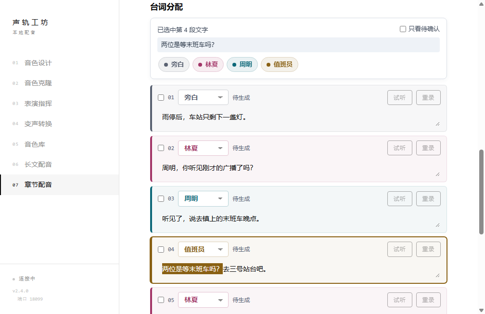

<h1 align="center">声轨工坊</h1>

<strong>Windows 本地多角色配音与字幕制作。</strong>

  <a href="https://github.com/dkvkvk/breeze-tts-2-desktop/releases"><strong>下载 · Windows x64</strong></a>
  · <a href="#快速开始">快速开始</a>
  · <a href="docs/guide.md">使用手册</a>
  · <a href="docs/development.md">开发文档</a>

声轨工坊是一个开源 Windows 本地配音应用。它将小说章节和剧本制作成多角色音频与字幕，也提供音色设计、参考音色管理和本机 Agent 接口。推理基于 [Breeze TTS 2 模型](https://huggingface.co/BreezeBlue/Breeze-TTS-2)和 [Breeze-TTS-2.cpp](https://github.com/HoppouAI/Breeze-TTS-2.cpp)。

[试听「雨后的末班车」四角色样音](https://raw.githubusercontent.com/dkvkvk/breeze-tts-2-desktop/main/docs/examples/chapter-demo.wav) · [原始剧本 TXT](docs/examples/chapter-demo.txt) · [角色字幕 SRT](docs/examples/chapter-demo.srt)

[《斗破苍穹》第一章导读示例](docs/examples/first-chapter/README.md)，演示在小说正文中识别对白、分配音色和导出角色字幕。

## 核心功能

| 功能 | 使用方式 |
| --- | --- |
| **多角色章节配音** | 连续正文保留原排版，自动标记对白。选中文字可套用或新建音色，用彩色下划线区分角色。 |
| **音色设计** | 用自然语言描述想要的声音。常用描述可以保存为本地预设，重启后继续使用。 |
| **音色克隆与表演指挥** | 从获授权的参考录音建立音色，再用文字调整语气、情绪和语速。 |
| **长文配音** | 粘贴脚本或导入 UTF-8 TXT，自动分段，设置段间停顿，逐段或整篇试听。当前任务停止或失败后可继续生成。 |
| **音频与字幕导出** | 导出 24 kHz 单声道 WAV 和同名 SRT。字幕时间按各段实际音频时长计算，可与 WAV 一起导入剪辑软件。 |
| **配音草稿与音色库** | 将脚本和配音设置保存为 JSON 草稿。参考音色可从文件批量导入并在各页面复用。 |
| **变声转换** | 为已有 WAV 录音选择目标音色，保留原录音的说话节奏。 |

## 快速开始

1. **下载安装包。** 在 [GitHub Releases](https://github.com/dkvkvk/breeze-tts-2-desktop/releases) 下载 `VoiceTrackStudio-Setup-*.exe`，双击运行并选择安装位置。
2. **准备模型。** 首次打开应用后，可以下载默认 Q4_K 模型（约 2.54 GB，支持断点续传），也可以选择已下载的 Breeze TTS 2 `.gguf` 文件。安装包已包含推理运行时，模型权重需要单独准备。
3. **生成第一段语音。** 打开「音色设计」，输入台词和可选的音色描述，点击「生成语音」。完成后可试听并下载 WAV。

## 长文配音流程

[试听约 21 秒的示例 WAV](https://raw.githubusercontent.com/dkvkvk/breeze-tts-2-desktop/main/docs/examples/quickstart.wav) · [原始脚本 TXT](docs/examples/quickstart.txt) · [配套字幕 SRT](docs/examples/quickstart.srt) · [示例说明](docs/examples/README.md)

1. 打开「长文配音」，导入 TXT 或粘贴脚本。换行会开启新段，过长的段落会按附近的标点或空格拆分。
2. 选择参考音色或填写音色描述，设置段间停顿。生成过程中可以停止，继续时会保留已完成的片段。
3. 逐段试听后，导出 WAV 和 SRT。需要下次接着编辑脚本时，另存一份 JSON 配音草稿。

草稿保存脚本、音色设置与段间停顿。生成的音频和字幕需单独导出。更多关于模型切换、批量导入音色和数据位置的说明见[使用手册](docs/guide.md)。

## 章节配音与 Agent 接入

像批注书页一样给正文配音。选中句子后，可套用预设音色或新建音色。台词以对应角色颜色的下划线显示，正文保留原有段落和标点。自动识别会标出明确的对白，归属不清的地方可手动确认。项目和已生成片段可以在下次启动时继续使用。

支持本机 HTTP 和 MCP。Agent 提交的章节能在桌面项目历史里打开，接着完成校对和配音。参见[章节配音操作指南](docs/chapter-workflow.md)和[本机 Agent 接入文档](docs/agent-api.md)。

## 开发与许可

- [开发文档](docs/development.md)包含本机 API、源码构建、测试命令和项目结构。
- 桌面版源码采用 [Apache-2.0](LICENSE)。模型权重适用上游的 BreezeBlue Research and Non-Commercial License，使用前请查阅[模型条款](https://huggingface.co/HoppouAI/Breeze-TTS-2.cpp)和[第三方组件声明](THIRD_PARTY_NOTICES.txt)。

声轨工坊是独立开发的应用。Breeze TTS 2 为上游模型名称。
