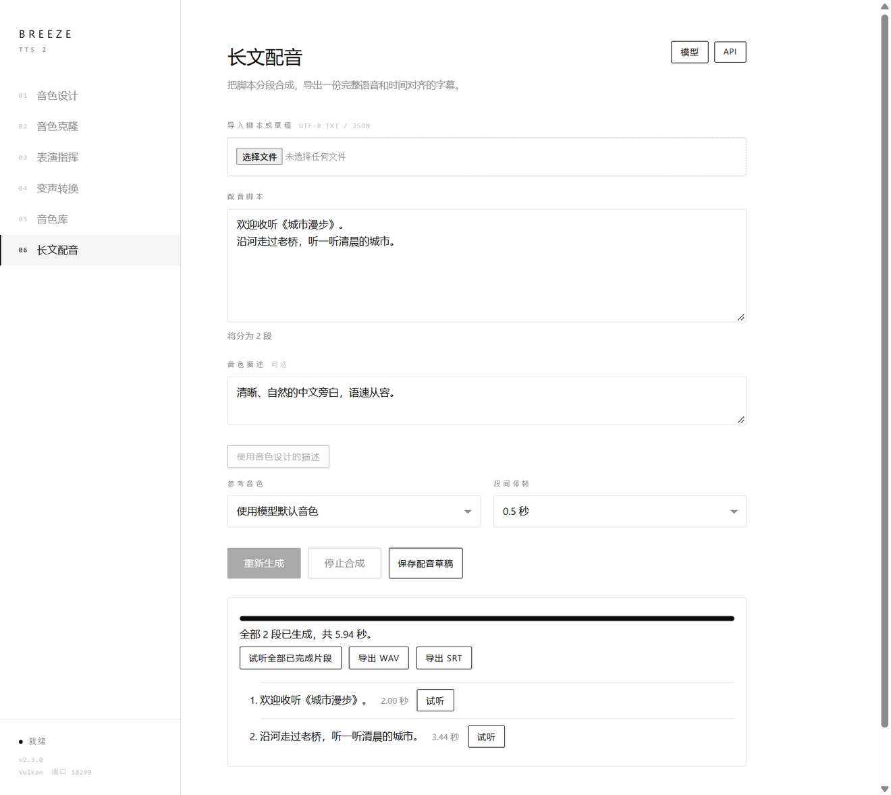

<h1 align="center">Breeze TTS 2 桌面版</h1>

<strong>在 Windows 上完成语音合成、长文配音和字幕导出。</strong>

  <a href="https://github.com/dkvkvk/breeze-tts-2-desktop/actions/runs/44763324249/artifacts/14643506219"><strong>下载 2.3.0 · Windows x64</strong></a>
  · <a href="#快速开始">快速开始</a>
  · <a href="docs/guide.md">使用手册</a>
  · <a href="docs/development.md">开发文档</a>

Breeze TTS 2 桌面版是基于 [Breeze-TTS-2.cpp](https://github.com/HoppouAI/Breeze-TTS-2.cpp) 的开源 Windows 应用。它提供中文操作界面，可以用文字设计声音、管理参考音色，也可以把一篇脚本制作成带字幕的旁白。模型下载完成后，语音合成在本机运行。

## 核心功能

| 功能 | 使用方式 |
| --- | --- |
| **音色设计** | 用自然语言描述想要的声音。常用描述可以保存为本地预设，重启后继续使用。 |
| **音色克隆与表演指挥** | 从获授权的参考录音建立音色，再用文字调整语气、情绪和语速。 |
| **长文配音** | 粘贴脚本或导入 UTF-8 TXT，自动分段，设置段间停顿，逐段或整篇试听。当前任务停止或失败后可继续生成。 |
| **音频与字幕导出** | 导出 24 kHz 单声道 WAV 和同名 SRT。字幕时间按各段实际音频时长计算，可与 WAV 一起导入剪辑软件。 |
| **配音草稿与音色库** | 将脚本和配音设置保存为 JSON 草稿。参考音色可从文件批量导入并在各页面复用。 |
| **变声转换** | 为已有 WAV 录音选择目标音色，保留原录音的说话节奏。 |

## 快速开始

1. **下载安装包。** [2.3.0 主分支构建](https://github.com/dkvkvk/breeze-tts-2-desktop/actions/runs/44763324249) 已通过 Windows 安装和首次启动检查。登录 GitHub 后，在页面底部的 **Artifacts** 中下载 `BreezeTTS2-Setup`，解压并运行 `BreezeTTS2-Setup-2.3.0.exe`。如果该产物已过期，可查看[主分支的近期成功构建](https://github.com/dkvkvk/breeze-tts-2-desktop/actions/workflows/build.yml?query=branch%3Amain+is%3Asuccess)。历史安装包可在 [GitHub Releases](https://github.com/dkvkvk/breeze-tts-2-desktop/releases) 获取。
2. **准备模型。** 首次打开应用后，可以下载默认 Q4_K 模型（约 2.54 GB，支持断点续传），也可以选择已下载的 Breeze TTS 2 `.gguf` 文件。安装包已包含推理运行时，模型权重需要单独准备。
3. **生成第一段语音。** 打开「音色设计」，输入台词和可选的音色描述，点击「生成语音」。完成后可试听并下载 WAV。

## 长文配音流程

1. 打开「长文配音」，导入 TXT 或粘贴脚本。换行会开启新段，过长的段落会按附近的标点或空格拆分。
2. 选择参考音色或填写音色描述，设置段间停顿。生成过程中可以停止，继续时会保留已完成的片段。
3. 逐段试听后，导出 WAV 和 SRT。需要下次接着编辑脚本时，另存一份 JSON 配音草稿。

草稿保存脚本、音色设置与段间停顿。生成的音频和字幕需单独导出。更多关于模型切换、批量导入音色和数据位置的说明见[使用手册](docs/guide.md)。

## 开发与许可

- [开发文档](docs/development.md)包含本机 API、源码构建、测试命令和项目结构。
- 桌面版源码采用 [Apache-2.0](LICENSE)。模型权重适用上游的 BreezeBlue Research and Non-Commercial License，使用前请查阅[模型条款](https://huggingface.co/HoppouAI/Breeze-TTS-2.cpp)和[第三方组件声明](THIRD_PARTY_NOTICES.txt)。

本项目是独立开发的 Breeze TTS 2 非官方桌面版。
