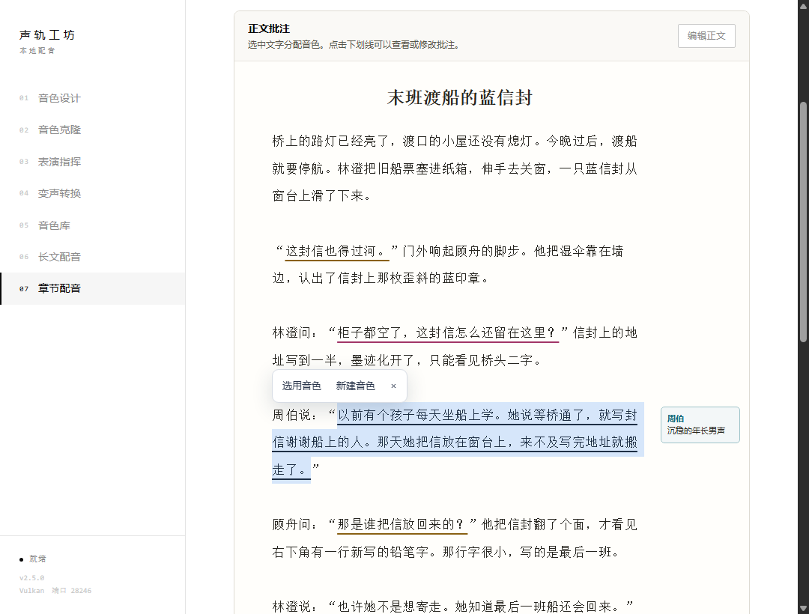

# 末班渡船的蓝信封

这是一篇为声轨工坊创作的完整原创短篇。渡船停航前，一封没有寄出的信让三个人登上了最后一班船。

[试听完整 WAV（1 分 47 秒）](https://raw.githubusercontent.com/dkvkvk/breeze-tts-2-desktop/main/docs/examples/blue-envelope/blue-envelope.wav) · [导入用 TXT](blue-envelope.txt) · [角色字幕 SRT](blue-envelope.srt) · [全篇标注长图](annotation-full.png)

| 角色 | 配音方向 |
| --- | --- |
| 旁白 | 平静的叙事男声。保留渡口最后一晚的安静气氛。 |
| 林澄 | 清亮的青年女声。从发现信封时的好奇，逐渐转为笃定。 |
| 周伯 | 沉稳的年长男声。讲起旧事时语速放缓，像在回忆一件日常小事。 |
| 顾舟 | 自然的青年男声。发问时干脆，决定登船时语气轻松。 |

1. 在「章节配音」导入 TXT，点击「识别对白并标注」。
2. 听到第一句对白后，从后面的脚步描写可以判断说话人是顾舟。在正文中选中这句，手动分配给他。其余对白可以依据明确的角色名核对标注。
3. 为每个角色分配固定音色，段间停顿设为 0.25 秒，勾选「字幕显示角色名」。生成后可导出 24 kHz 单声道 WAV 和对齐的 SRT。

正文为本项目原创。四种音色均以本地 Breeze TTS 2 Q4_K 模型合成，音频用于非商业演示。 [BreezeBlue 模型与输出许可](https://huggingface.co/BreezeBlue/Breeze-TTS-2/blob/main/LICENSE)
